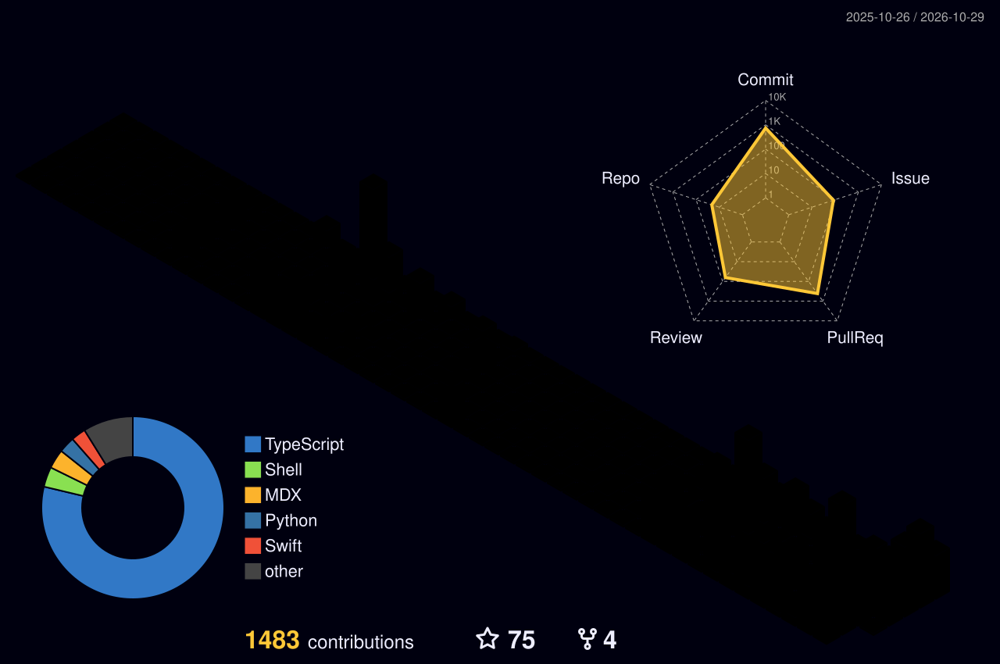

## Lead Engineer @ Capital One · TypeScript/JavaScript · building web components and small tools

### [quincarter.com](https://quincarter.com) · Richmond, VA · [84 public repos](https://github.com/quincarter?tab=repositories) · 11 followers

> [!NOTE]
> 🏆 **Arctic Code Vault Contributor, Pull Shark x3, Pair Extraordinaire**: code preserved in GitHub's 2020 Arctic Code Vault archive, still shipping.

  
  
  

  

| | Repo | Description | Stars | Forks |
|:-:|---|---|:-:|:-:|
| 🧩 | [component-library-starter](https://github.com/quincarter/component-library-starter) | Starter repo for a component library |  |  |
| 📄 | [document-viewer-web-component](https://github.com/quincarter/document-viewer-web-component) | Standalone web component for rendering documents of any file type |  |  |
| 📊 | [ClaudeUsage-MacOS-App-Widget](https://github.com/quincarter/ClaudeUsage-MacOS-App-Widget) | Native macOS menu bar app and desktop widgets to track Claude usage across multiple accounts and monitor global peak hours in real time |  |  |
| 🧠 | [llms-txt-files-and-converters](https://github.com/quincarter/llms-txt-files-and-converters) | Python scripts and pre-converted LLM-context files for turning docs/codebases into `llms.txt`-style ingestion text |  |  |
| 🏠 | [hass-decluttering-card-explorer](https://github.com/quincarter/hass-decluttering-card-explorer) | Home Assistant Lovelace card for browsing decluttering-card templates |  |  |
| ⚡ | [create-lit-app](https://github.com/quincarter/create-lit-app) | CLI to scaffold a new Lit app |  |  |
| ☕ | [brew-me-app-lit](https://github.com/quincarter/brew-me-app-lit) | Coffee ratio calculator, pour-over timer, and brew guide PWA (Lit 3 + TypeScript), with optional Bluetooth scale telemetry |  |  |
| 🎬 | [ive-got-this-extension](https://github.com/quincarter/ive-got-this-extension) | Browser extension for Emby/Jellyfin + Overseerr/Jellyseerr, sideloadable on Chrome and Edge |  |  |
| 🌐 | [quincarter-portfolio-astro](https://github.com/quincarter/quincarter-portfolio-astro) | Personal portfolio site built with Astro, React, and Tailwind |  |  |
| 💸 | [two-week-budget-docker](https://github.com/quincarter/two-week-budget-docker) | Docker Compose deployment for Two Week Budget, a self-hosted bi-weekly budget app |  |  |
| 🐚 | [app-shell-starter](https://github.com/quincarter/app-shell-starter) | Lit app shell starter template |  |  |
| 🔕 | [dnd-syncer](https://github.com/quincarter/dnd-syncer) | Cross-platform system to sync Do Not Disturb/Focus status and notifications in real-time between Android and desktop (macOS, Windows, Linux) over encrypted local Wi-Fi |  |  |
| 🦸 | [marvel-champions-digital-game](https://github.com/quincarter/marvel-champions-digital-game) | Digital, rules-accurate implementation of Marvel Champions: The Card Game with a deterministic headless engine and Phaser 4 client |  |  |

- **`n01` ☕ [BrewMe](https://github.com/quincarter/brew-me-app-lit):** adding Aeropress, Hario Switch, and Clever Dripper support
- **`n02` 🔕 [dnd-syncer](https://github.com/quincarter/dnd-syncer):** DND/notification sync between Android and desktop
- **`n03` 🧱 Slidebox:** an Android sliding-block puzzle game built with Kotlin + Jetpack Compose

  
  
  
  
  
  

  

  <picture>
    <source media="(prefers-color-scheme: dark)" srcset="https://raw.githubusercontent.com/quincarter/quincarter/output/github-snake-dark.svg" />
    <source media="(prefers-color-scheme: light)" srcset="https://raw.githubusercontent.com/quincarter/quincarter/output/github-snake.svg" />
    
  </picture>

  

  

  
  

⟡ system nominal · signals regenerate daily via GitHub Actions ⟡

